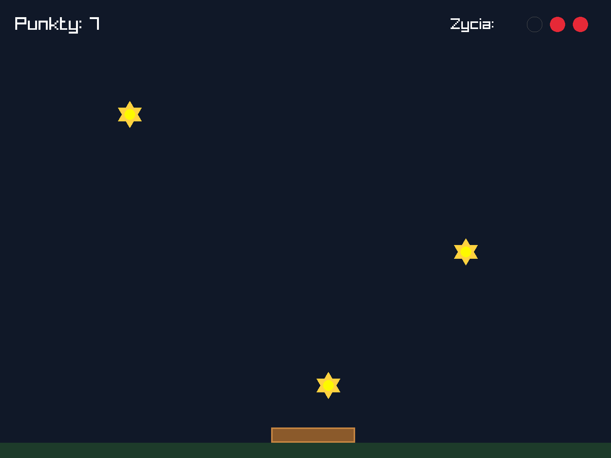
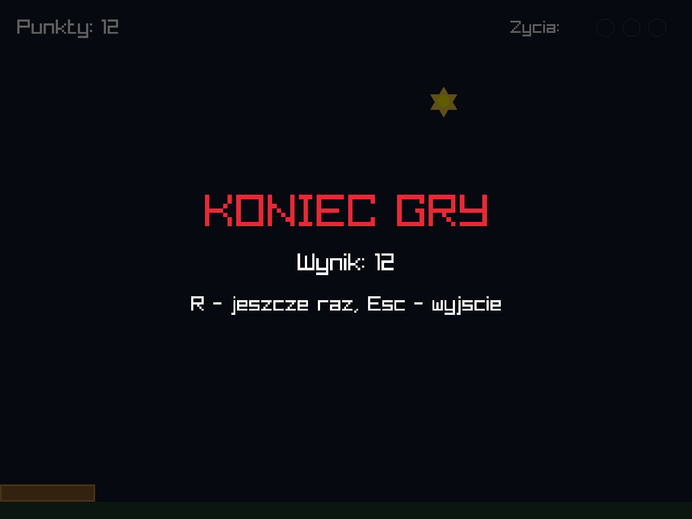

# Łapacz gwiazd


Gra 2D w Ducklingu według tutorialu **„Gry 2D w Ducklingu: pakiety grafika i fizyka, od okna do pierwszej gry”** (kroki 1–4).
Z góry spadają gwiazdy, a Ty przesuwasz koszyk. Złapana gwiazda daje punkt, gwiazda na ziemi zabiera życie. Po trzech stratach gra się kończy, a R zaczyna od nowa.





## Sterowanie

| Klawisz | Działanie |
|---|---|
| ← → albo A / D | ruch koszyka |
| R | nowa gra (na ekranie końca gry) |
| Esc albo zamknięcie okna | wyjście |

## Uruchomienie (macOS)

```sh
./uruchom.sh          # buduje i uruchamia grę
./uruchom.sh testy    # testy logiki, bez okna
```

Wymagania:
* Duckling z `duck` w PATH (sprawdzone na `duckc 0.3-alpha (83882805a 2026-11-20)`, macOS 27.2, Apple Silicon);
* Xcode Command Line Tools (git, make, clang);
* nic więcej: pakiet `grafika` oraz raylib dla macOS (Apple Silicon) są w katalogu `zewnetrzne/` (opis: [zewnetrzne/README.md](zewnetrzne/README.md)), więc nie trzeba pobierać duckling-biblioteki ani budować raylib;

Ręcznie: `cd gra && duck run`.

`duck` trzyma jedno środowisko (venv) na nazwę pakietu. Druga kopia projektu na tym samym komputerze kończy się błędem „would overwrite the venv”: zmień w niej `name` w `quackconfig.yaml` albo dodaj `--overwrite`.

## Uruchomienie (Linux)

```sh
sudo apt install build-essential git cmake libx11-dev libxrandr-dev libxinerama-dev \
    libxcursor-dev libxi-dev libgl-dev libasound2-dev
./uruchom.sh          # za pierwszym razem uruchamia ./przygotuj_linux.sh: wersje pakietów dla Linuksa i raylib
./uruchom.sh testy    # testy logiki, bez okna
```

Potrzebny jest też Duckling z `duck` w PATH. `przygotuj_linux.sh` kopiuje wersje pakietów z `zewnetrzne/linux/` do `zewnetrzne/` (pliki z repozytorium dostają w git znacznik `skip-worktree`, więc `git status` pozostaje czysty) i buduje statyczną raylib 5.5 skryptem pakietu `grafika`. **Kroki dla Linuksa nie zostały sprawdzone na prawdziwej maszynie z Linuksem.**

## Struktura

```
logika/   pakiet logika: zasady gry (model), bez okna; generator liczb losowych z ziarnem
gra/      pakiet lapacz: okno, klawiatura, rysowanie (grafika) i pętla gry
testy/    pakiet testy_lapacza: 28 sprawdzeń logiki, kod wyjścia = liczba błędów
zrzuty/   obrazy do README, tworzone przez grę: LAPACZ_ZRZUTY=1 gra/.duck_build/dev/lapacz
zewnetrzne/          pakiet grafika (wersje dla macOS i Linuksa) oraz raylib dla macOS; opis w zewnetrzne/README.md
przygotuj_macos.sh   buduje raylib, gdy brakuje jej dla procesora Maca (np. Intel)
przygotuj_linux.sh   przygotowanie na Linuksie: wersje pakietów z zewnetrzne/linux/ i raylib
```

Logika jest oddzielona od okna, tak jak radzą materiały DuckQuest. Dzięki temu da się ją sprawdzić testami bez ekranu, a pętla w `gra/` ma tylko trzy części: wejście, zmiana stanu i rysowanie.

## Zgodność z tutorialem

| Tutorial | Gdzie w kodzie |
|---|---|
| Krok 1: okno 800×600, `setTargetFps(60)`, pętla do Esc albo zamknięcia okna | `gra/src/src.dk`, `main` |
| Krok 2: koszyk 110×20 na y = 560, strzałki i A/D, 450 px/s × `dt` | `logika.krokCzastkowy` |
| Krok 3: gwiazda o promieniu 14, warunek złapania „dotknęła od góry i jest nad koszykiem”, punkty | `logika.wKoszyku` |
| Krok 4: `class Gwiazda`, `List[Gwiazda]`, `nowaGwiazda()` z x 30…770, y −600…−30, prędkością 120…220 | `logika.nowaGwiazda` |
| Krok 4: 3 życia, gwiazda poniżej `WYSOKOSC + PROMIEN` zabiera życie, „KONIEC GRY”, R zaczyna od nowa | `logika.aktualizuj`, `logika.odNowa`, `gra.rysujScene` |

Dodatki, które nie zmieniają zasad gry:
* koszyk nie wychodzi poza ekran;
* długa klatka (np. po przeciągnięciu okna) jest dzielona na kroki po najwyżej 0,05 s, więc gwiazda nie przeskoczy koszyka;
* przerwa dłuższa niż 1 s nie jest nadrabiana;
* gwiazdy rysowane są jako heksagramy, z ziemią i sercami żyć;
* gdy okno się nie otworzy, gra wypisuje czytelny błąd i kończy się kodem 1.

## Uwagi o macOS

Pakiet `grafika` z duckling-biblioteki jest przygotowany dla Linuksa. Wersja dla macOS w `zewnetrzne/` różni się od oryginału tylko tym:

* **raylib 5.5 jako `libraylib.dylib`.** Biblioteka współdzielona sama dołącza frameworki macOS, a `duck` przyjmuje tylko nazwy bibliotek (`external-libs`), bez flag `-framework`. Homebrew ma już raylib 6.x, a pakiet `grafika` opisuje struktury z 5.5, dlatego skrypt buduje 5.5 ze źródeł (ten sam commit co `grafika/zbuduj_raylib.py`).
* **`__errno_location` → `__error`.** Tak nazywa się ta funkcja na macOS.
* **`clock_gettime(1, …)` → `clock_gettime(6, …)`.** Na macOS `CLOCK_MONOTONIC` ma numer 6.

Przy pisaniu gry znalazła się pułapka spoza listy `PULAPKI-DUCKLINGA.md`: **`restart` jest słowem kluczowym** („Expected an identifier”), dlatego funkcja nazywa się `odNowa`.

## Licencja

MIT. Kopia pakietu `grafika` w `zewnetrzne/` pochodzi z duckling-biblioteki (MIT, Paweł Kępczyński; szczegóły w `zewnetrzne/README.md`), a raylib ma licencję zlib.
